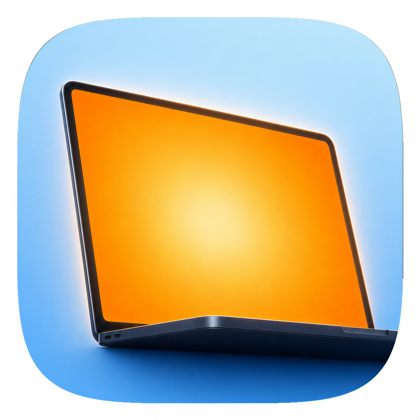
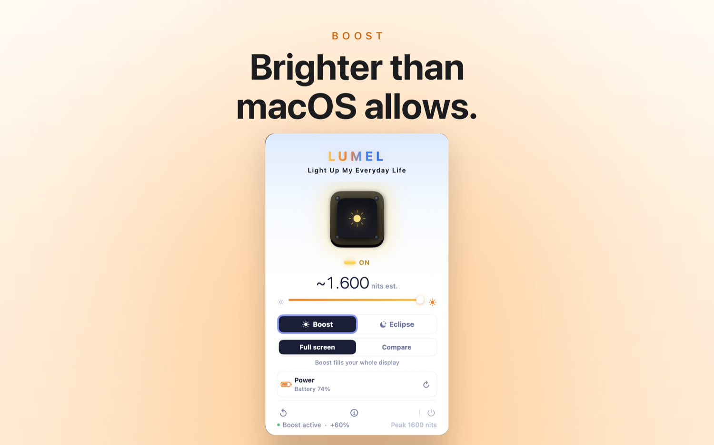
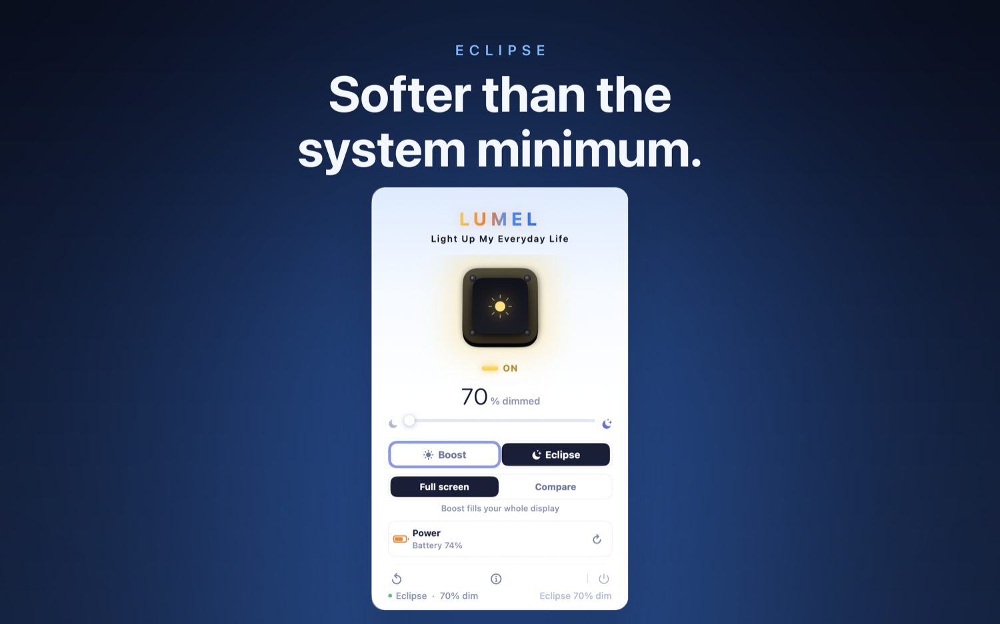
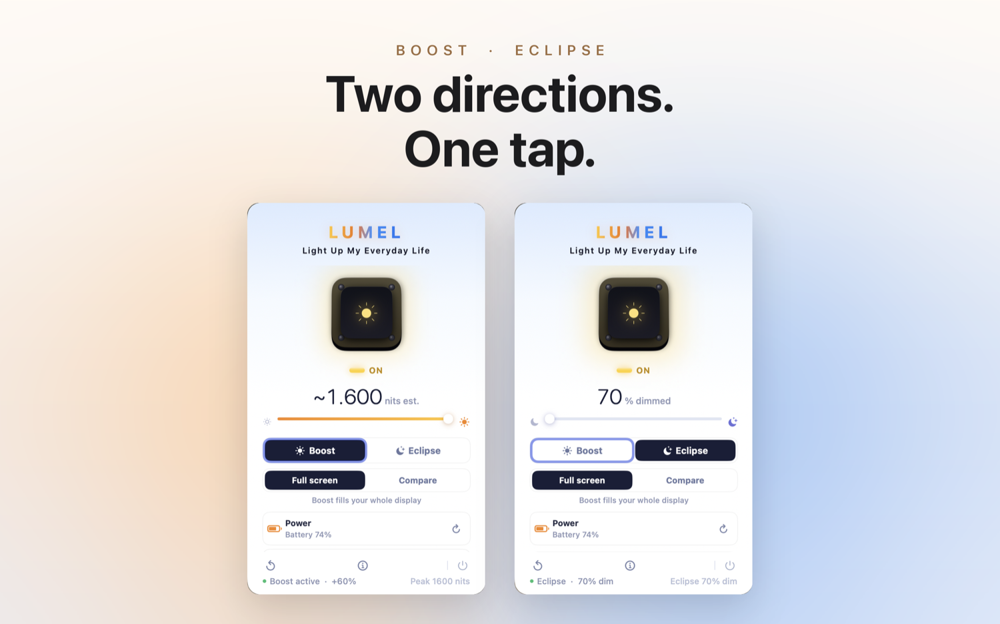

# LUMEL

### Make your Mac brighter than macOS allows, or dimmer than its minimum.

**LUMEL** is a tiny macOS menu-bar app that unlocks the brightness range your Mac already has but hides. Boost a supported **XDR display into the EDR headroom it reports** for sunlight, **dim below the macOS floor** for dark rooms at night, or light your face on video calls with **Face Light**. Free to download; a one-time **LUMEL Pro** purchase ($4.99 in the US) unlocks full-screen boost. No subscription, no account, no data collected.

**[⬇️ Download on the Mac App Store](https://apps.apple.com/us/app/lumel/id6776136831)&nbsp; · &nbsp;[🌐 getlumel.app](https://getlumel.app)&nbsp; · &nbsp;[🐞 Report a bug / request a feature](https://github.com/onekapisch/LUMEL-public/issues/new/choose)**

 

> [!NOTE]
> **LUMEL is a commercial, closed-source Mac app.** This repository hosts its **docs, release notes, and issue tracker**, not the source code. Found a bug or want a feature? [Open an issue](https://github.com/onekapisch/LUMEL-public/issues/new/choose). They're read and welcomed.

---

## Why

macOS quietly caps two things:

- **Everyday (SDR) brightness is capped.** macOS keeps part of an XDR display's range in reserve for HDR content; how much depends on the MacBook Pro generation. Step into sunlight and the screen washes out.
- **The brightness slider won't go below a fixed floor.** In a dark room at night, even the lowest setting can feel harsh, a common cause of eye strain. (Apple's own 2024 MacBook Pro displays were widely covered for going *"even dimmer in low light"*, proof both ends of the range matter.)

LUMEL fixes **both**, from the menu bar, using Apple's public Extended Dynamic Range rendering. No private APIs, no system hacks.

## What you get

- ☀️ **Boost beyond the cap:** use the EDR headroom a supported XDR display reports, so it stays readable in direct sunlight. The gain depends on the display.
- 🌙 **Eclipse: dim below the minimum.** Go darker than macOS allows for night reading and dark rooms. *Free and unlimited.*
- ↔️ **Both directions, one app:** brighten past the cap **and** dim below the minimum, from one menu-bar app.
- ⌨️ **Your own global shortcuts:** on/off, brighter and dimmer (defaults ⌃⌥⌘B, ⌃⌥⌘↑, ⌃⌥⌘↓). **No Accessibility permission required.**
- 🔋 **Battery-aware:** set a 5-50% threshold (or Off) and boost switches off automatically; Low Power Mode disables it too.
- ⏲️ **Optional auto-off timer:** 30 min / 1 h / 2 h, so sustained brightness never sneaks up on you.
- 🖥️ **Per-display memory:** on/off per screen, remembered across reconnects, sleep, and hot-plug.
- 💡 **Face Light:** a soft ring of light around the screen edges to light your face on video calls, warm or cool. It stays out of screen shares and recordings.
- 🗣️ **Shortcuts and Siri:** LUMEL actions in the Shortcuts app, plus a Control Center toggle on macOS 26 or later.
- 🌍 **Seven languages:** English, German, French, Spanish, Japanese, Simplified and Traditional Chinese.
- 🔒 **Private by architecture:** sandboxed, no network entitlement, collects nothing. See **[SECURITY.md](SECURITY.md)**.

&nbsp;

## Supported Macs

| Display | Boost (brighter than max) | Eclipse (dim below min) |
|---|:--:|:--:|
| 14″ / 16″ MacBook Pro (Apple silicon, XDR) | ✅ | ✅ |
| Pro Display XDR · Studio Display XDR | ✅ | ✅ |
| Other Macs / external monitors | No *(needs EDR headroom)* | ✅ |

Boost requires a display that reports Extended Dynamic Range headroom. On displays without it, LUMEL still runs and **Eclipse dimming still works**, so the boost controls simply stay inactive until a compatible display is connected.

## How it compares

An honest look at the apps people ask about: differences, not trash-talk.

| | **LUMEL** | Vivid | BrightIntosh | LumiMax |
|---|:--:|:--:|:--:|:--:|
| **Direction** | **Brighten + dim** | Brighten + dim | Brighten only | Brighten only |
| **Dim below minimum** | ✅ Eclipse | ✅ Eclipse mode | ❌ | ❌ |
| **Price** | **Free + $4.99 once** | €10 · $24.99 App Store | $1.99 once | $17.99 |
| **Free tier** | ✅ Compare boost + full Eclipse | Watermark demo | 3‑day trial | 3‑day trial |
| **Native brightness keys** | ❌ *(sandbox trade-off)* | ✅ | ✅ | ✅ |
| **Collects no data** | ✅ | ✅ | ✅ | ✅ |
| **Open source** | ❌ | ❌ | ✅ | ❌ |

**Where others win:** Vivid, BrightIntosh, and LumiMax hook into your Mac's **native brightness keys**; LUMEL trades that away to stay sandboxed and permission-free. BrightIntosh is also **open-source and $1.99**, so it's cheaper. If below-minimum dimming, a free tier that never expires, and a single app for both directions matter more to you, that's LUMEL. *Competitor prices verified June 2026. Check each store for current pricing.*

## Privacy & security

LUMEL is **sandboxed with no network entitlement**, so it cannot send data off your Mac. No analytics, no telemetry, no accounts, no ads. The optional Pro purchase is handled by the App Store (StoreKit), not by LUMEL. Full details in **[SECURITY.md](SECURITY.md)**.

## Install

1. Open the **[Mac App Store listing](https://apps.apple.com/us/app/lumel/id6776136831)** and click **Get**.
2. Launch LUMEL. It lives in your **menu bar**.
3. Click the icon, choose **Boost**, **Eclipse** or **Face Light**, and drag the slider.
4. *(Optional)* Tap **Full screen** to unlock **LUMEL Pro** (one-time, $4.99 in the US) for whole-display boost across every screen.

- **Update:** via the Mac App Store → Updates (auto-updates if enabled).
- **Uninstall:** quit LUMEL, then remove it from the App Store (Uninstall) or `/Applications`. It leaves nothing behind but a small preferences file in `~/Library`.
- **Requirements:** macOS 13 (Ventura) or later. Boost requires an EDR/XDR-capable display.

## Roadmap & feedback

Have a bug, a Mac that should be supported, or a feature idea? **[Open an issue](https://github.com/onekapisch/LUMEL-public/issues/new/choose)**. This tracker is the official place for it, and it shapes the roadmap.

## FAQ

**Is LUMEL open source?**
No. LUMEL is a commercial, closed-source app on the Mac App Store. This repository hosts its docs, release notes, and issue tracker. (Prefer open source? [BrightIntosh](https://brightintosh.de/) is a solid GPL-licensed, brighten-only option.)

**Why pay for Pro when BrightIntosh is $1.99 (and free apps exist)?**
BrightIntosh only brightens. LUMEL also **dims below the minimum** with Eclipse, and its free tier (Compare boost plus **unlimited Eclipse dimming**) never expires. The other two-way apps, Vivid and Lunar, cost more. If you only ever brighten, a cheaper brighten-only app may suit you better, and that's fine.

**Does it collect any data?**
No. Sandboxed, no network entitlement, no analytics or accounts. Your preferences stay on your Mac. See [SECURITY.md](SECURITY.md).

**Which Macs work?**
Boost needs an EDR/XDR display (14″/16″ MacBook Pro Apple silicon, Pro Display XDR, Studio Display XDR). Eclipse dimming works on **any** Mac running macOS 13+.

---

**If LUMEL makes your Mac better, [⭐ star this repo](https://github.com/onekapisch/LUMEL-public). It helps others find it.**

[Download](https://apps.apple.com/us/app/lumel/id6776136831) · [Website](https://getlumel.app) · [Report an issue](https://github.com/onekapisch/LUMEL-public/issues/new/choose) · [Security](SECURITY.md) · [Changelog](CHANGELOG.md)

Not affiliated with Apple Inc. macOS, MacBook, and Mac are trademarks of Apple Inc.

